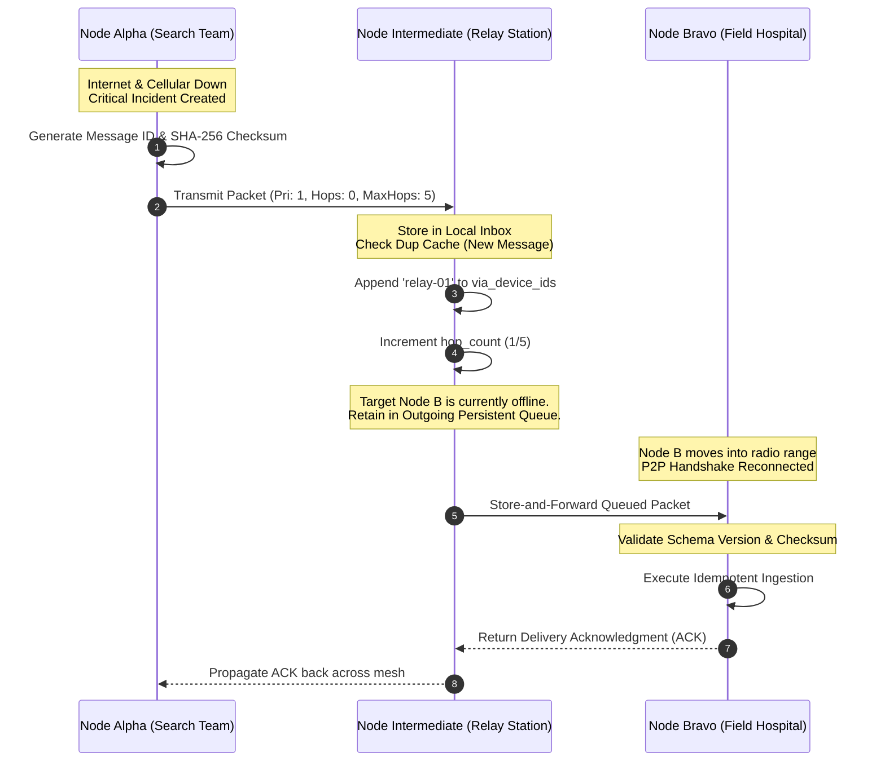

# ResQMesh — AI Mesh Networks & Disaster Response Coordination
### Offline-First Decentralized Emergency Command System for Resilient Humanitarian Operations

[](https://www.python.org/)
[](https://fastapi.tiangolo.com/)
[](https://vitejs.dev/)
[](https://www.typescriptlang.org/)
[](https://tailwindcss.com/)
[]()
[]()

---

## 1. Executive Summary & Mission

During catastrophic emergencies (hurricanes, earthquakes, flash floods, armed conflicts), the primary casualty is frequently communication infrastructure: cellular towers lose power, fiber backbones sever, and centralized cloud servers become unreachable. Emergency services and civilian volunteer teams are plunged into information blackouts.

**ResQMesh** is an offline-first, decentralized disaster-response coordination platform that transforms standard laptops, tablets, and field workstations into autonomous mesh nodes. Devices communicate via local store-and-forward protocols and local Wi-Fi / ad-hoc transports without requiring internet access, satellite subscriptions, or centralized cloud backends.

Equipped with four deterministic, explainable AI agents and strict **Human-in-the-Loop** verification, ResQMesh enables field teams to:
1. Intake, deduplicate, and triage high-priority incident reports.
2. Coordinate rescue teams while detecting scheduling and capacity conflicts.
3. Manage relief inventories using an append-only, tamper-resistant transaction ledger that mathematically prevents negative balances and double allocations.
4. Visualize situational geometry on interactive maps with zero-tile tactical radar fallbacks when cartographic tile servers are down.
5. Propagate prioritized telemetry across ad-hoc peer nodes with multi-hop relaying, hop limits, loop prevention, and conflict resolution.

---

## 2. Architecture & System Flow

```
                                +---------------------------------------------+
                                |          ResQMesh Web Command Center        |
                                |       React 18 + TypeScript + Tailwind      |
                                +----------------------+----------------------+
                                                       |
                                            WebSocket + REST APIs
                                                       |
                                                       v
+---------------------------------------------------------------------------------------------------------+
|                                    ResQMesh Node Engine (FastAPI)                                       |
|                                                                                                         |
|  +--------------------+   +---------------------+   +---------------------+   +---------------------+  |
|  |   Incident Agent   |   |   Task Coord Agent  |   |    Supply Agent     |   |  Spatial Map Agent  |  |
|  | Keyword Urgency,   |   | Capability Matching,|   | Transaction Ledger, |   | Cluster Detection,  |  |
|  | Deduplication (1hr)|   | Double-Book Alerts  |   | Reserve Protection  |   | Distance Heuristics |  |
|  +---------+----------+   +----------+----------+   +----------+----------+   +----------+----------+  |
|            |                         |                         |                         |              |
|            +-------------------------+------------+------------+-------------------------+              |
|                                                   |                                                     |
|                                                   v                                                     |
|                                     +---------------------------+                                       |
|                                     | Human Decision Guardrail  |                                       |
|                                     | (Sign-Off & Audit Log)    |                                       |
|                                     +-------------+-------------+                                       |
|                                                   |                                                     |
|                                                   v                                                     |
|  +------------------------------------------------+--------------------------------------------------+  |
|  |                                  Local Persistence Layer (SQLite)                                 |  |
|  |    Incidents  *  Tasks  *  Supplies  *  Transactions  *  Peers  *  SyncMessages  *  AuditLog       |  |
|  +------------------------------------------------+--------------------------------------------------+  |
|                                                   |                                                     |
|                                                   v                                                     |
|  +------------------------------------------------+--------------------------------------------------+  |
|  |                             Store-and-Forward Mesh Engine (P2P Bus)                              |  |
|  |   Prioritized Queues * Multi-Hop Forwarding * Loop & TTL Guards * Cryptographic Message Checksums   |  |
|  +------------------------------------------------+--------------------------------------------------+  |
+---------------------------------------------------|-----------------------------------------------------+
                                                    |
                                      Ad-Hoc P2P Wireless Mesh Bus
                                     (Simulated / LAN / Wi-Fi Direct)
                                                    |
                          +-------------------------+-------------------------+
                          |                                                   |
                          v                                                   v
           +-----------------------------+                     +-----------------------------+
           |   Field Node: Rescue Alpha  | <=================> |   Field Node: Rescue Bravo  |
           |  (Search & Extraction Unit) |      Multi-Hop      |      (Mobile Paramedics)    |
           +-----------------------------+      Relaying       +-----------------------------+
```

### Multi-Hop Store-and-Forward Mesh Sequence

When two nodes cannot reach each other directly due to terrain or range limitations, intermediate nodes store the encrypted message, decrement the TTL (`max_hops`), append their identifier to the hop path, and forward it upon establishing peer proximity:



---

## 3. The 4 Local Autonomous AI Agents

ResQMesh embeds four transparent, deterministic, and explainable rule-based AI engines. By design, these agents require **zero external API keys, zero cloud subscriptions, and zero heavy GPU models**, ensuring they run instantaneously even on low-power tactical laptops.

| Agent Name | Core Responsibilities | Heuristic & Mathematical Rules | Test Coverage |
| :--- | :--- | :--- | :--- |
| **Incident Agent** (`IncidentAgent`) | Report validation, severity scoring, duplicate detection | Tokenizes natural language text; calculates priority score using weighted keyword dictionaries (trapped, life-threatening, infant, fire); flags duplicates within 500m radius and 60-minute window with confidence scores. | Tested (`test_backend.py::test_incident_duplicate_detection`) |
| **Task Coordination Agent** (`TaskCoordinationAgent`) | Dispatch recommendation, team capability matching, conflict detection | Ranks candidate incidents by elapsed time and severity; matches requirements (medical, boat, heavy extraction) to team profiles; detects and alerts on simultaneous critical assignment overloads (double-booking). | Tested (`test_backend.py::test_task_conflict_detection`) |
| **Supply Inventory Agent** (`SupplyAgent`) | Consumption forecasting, ration optimization, safety reserves | Computes dynamic available stock strictly from verified append-only transactions; protects mandatory emergency reserve thresholds (20%); generates rationalized relief distributions based on affected headcounts. | Tested (`test_backend.py::test_inventory_ledger_calculation`) |
| **Spatial Map Agent** (`SpatialMapAgent`) | Geospatial feature compilation, proximity clustering, synthetic coordinate safety | Aggregates shelters, depots, blocked passages, and incidents; computes euclidean and haversine proximity clusters; enforces strict synthetic coordinate flagging for privacy. | Tested (`test_backend.py::test_full_demo_scenario_workflow`) |

---

## 4. Human-in-the-Loop Safety & Privacy Guardrails

ResQMesh is engineered as a **decision-support platform**, explicitly adhering to emergency management protocols:

1. **No Autonomous Dispatch:** AI recommendations are presented with clear confidence percentages and plain-language reasoning. No rescue team is dispatched and no life-saving supplies are allocated until an authorized human commander clicks **"Approve & Execute"**.
2. **Double-Entry Append-Only Inventory Ledger:** Overwriting inventory balances via "Last-Write-Wins" is dangerous in distributed networks. ResQMesh models inventory strictly as signed transactions (`addition`, `distribution`, `adjustment`) with unique `idempotency_key` identifiers. If a distributed message is delivered twice, the duplicate key ensures it is processed exactly once without inflating or deflating stock.
3. **Explicit Conflict Resolution:** If two disconnected field stations concurrently alter the operational state of the same incident (e.g., Station A marks "Responding" while Station B marks "Resolved"), ResQMesh quarantines the competing states into a `ConflictRecord` for human commander inspection and resolution.
4. **Civilian Privacy & GPS Fuzzing:** The system provides built-in PII redaction and deliberate coordinate jittering on civilian emergency reports to prevent adversarial interception of vulnerable displacement camps.

---

## 5. Visual Design & Tactical Command Center

The user interface is designed with a high-contrast dark military/aerospace aesthetic:
- **Palette:** Dark Navy Void (`#050d1a`, `#0a1628`), Electric Cyan (`#06b6d4`), Vivid Violet (`#8b5cf6`), Emerald Green (`#10b981`), Amber Warning (`#f59e0b`), Coral Critical (`#ef4444`).
- **Surface Styling:** Glassmorphism card surfaces with subtle backdrop blur, glowing status pills, and interactive hover depth.
- **Hardware Telemetry HUD:** Real-time simulated indicators for node battery level, local storage consumed, mesh link latency, and peer topology.
- **Zero-Tile Tactical Radar Grid:** If internet cartography tile servers fail to load, the Disaster Map seamlessly falls back to a high-contrast tactical radar coordinate grid, ensuring spatial awareness is never lost during complete network blackouts.

### The 8 Command Center Pages

| # | Page | Key Capabilities |
| :---: | :--- | :--- |
| **1** | **Command Center** | Live KPI metrics, dynamic severity distribution doughnut chart, response status bar chart, live incident telemetry ticker, immutable system audit stream. |
| **2** | **Incident Management** | Incident reporting modal with instant duplicate warning, severity filtering, category filters, verification state toggles, and AI triage inspector. |
| **3** | **Rescue Tasks** | Tactical Kanban board, team capability assignments, double-booking conflict warnings, AI suggestion generator with human approval modal. |
| **4** | **Relief Inventory** | Granular ledger balances, transaction history with idempotency keys, new stock movement modal, and automated population ration optimizer. |
| **5** | **Disaster Map** | Interactive Leaflet layer with custom SVG markers, incident radii, shelter capacities, road blockades, and Zero-Tile Tactical Radar Fallback. |
| **6** | **Peer Network** | Interactive mesh topology visualizer, peer connect/disconnect simulation, network partition injection, and manual packet transmission. |
| **7** | **Sync Center** | Persistent store-and-forward queue inspector, packet checksum verification, manual retry controls, and side-by-side conflict resolver. |
| **8** | **Audit & Settings** | Immutable forensic audit log, local node hardware configurations, mesh frequency selector, and privacy fuzzing toggles. |

---

## 6. Feature Status Matrix: Honest Engineering Disclosure

| Capability | Status | Implementation Details |
| :--- | :---: | :--- |
| **FastAPI Synchronous SQLite Database** | **Implemented & Tested** | 100% native Python 3.14 compatible, zero greenlet/C-extension dependencies, synchronous threadpool session isolation. |
| **4 Deterministic AI Agents** | **Implemented & Tested** | Pure Python rule engines with explainable scoring, duplicate radius calculation, and ration sizing. |
| **Real-time WebSocket Broadcasts** | **Implemented & Tested** | Pub/Sub connection manager pushes instant data updates to all connected browser clients on every mutation. |
| **Store-and-Forward Message Engine** | **Implemented & Tested** | Persistent `sync_messages` table, SHA-256 payload checksums, hop limits, priority queueing, and deduplication. |
| **Append-Only Inventory Ledger** | **Implemented & Tested** | Double-entry transaction model with mathematical negative-stock guards and idempotency keys. |
| **Zero-Tile Tactical Radar Fallback** | **Implemented & Tested** | SVG tactical radar grid with dynamic coordinate mapping rendered when online tile servers are unreachable. |
| **10-Step Automated E2E Disaster Runner** | **Implemented & Tested** | Interactive modal and backend API (`/api/demo/simulate/step/{1-10}`) executing a 500-year flood disaster scenario. |
| **Simulated Mesh Peer Topology** | **Implemented & Tested** | Software simulation of node disconnects, message queueing during radio blackout, and automatic synchronization on reconnect. |
| *Physical LoRa SX1262 SPI Transceiver* | *Hardware Simulation* | Simulated via WebSocket/REST queues. Physical SPI driver requires hardware boards (e.g. Heltec V3, TTGO T-Beam). |
| *Android Wi-Fi Direct NsdManager* | *Platform Simulation* | Demonstrated using multi-client local network sockets. Native OS permission layer requires Android/iOS APK builds. |

---

## 7. Quickstart & Setup Instructions (Windows PowerShell)

### Prerequisites
- **Python 3.11+** (Tested on Python 3.14.3 64-bit)
- **Node.js 18+** (Tested on Node.js v26.2.0)
- **PowerShell** (Windows 10/11)

### Option A: One-Command Launcher (Recommended)

From the project root directory, run the included launcher:

```powershell
.\run-resqmesh.ps1
```
This automatically launches the FastAPI backend on `http://127.0.0.1:8000` and the Vite frontend on `http://127.0.0.1:5173` in separate PowerShell windows.

---

### Option B: Manual Step-by-Step Launch

#### 1. Backend Setup & Startup
Open a PowerShell terminal:
```powershell
cd d:\Synapse_Hackathon\backend

# Verify Python
python --version

# Run the automated pytest suite (13 tests)
python -m pytest -v

# Start the FastAPI server
python -m uvicorn main:app --host 127.0.0.1 --port 8000 --reload
```
*Backend API Documentation is available at: `http://127.0.0.1:8000/docs`*

#### 2. Frontend Setup & Startup
Open a second PowerShell terminal:
```powershell
cd d:\Synapse_Hackathon\frontend

# Install dependencies (already prepared)
npm install

# Run frontend Vitest test suite
npm test -- --run

# Verify production build
npm run build

# Start Vite development server
npm run dev -- --host 127.0.0.1 --port 5173
```
*Frontend Command Center is available at: `http://127.0.0.1:5173`*

---

## 8. Live Hackathon Demo Walkthrough Script (10-Step Showcase)

When presenting to hackathon judges, follow this concise script:

1. **Open the Dashboard (`http://127.0.0.1:5173`)**: Show the dark tactical UI, live UTC clock, hardware battery status, and empty KPI cards.
2. **Initialize Demo Scenario**: Click the cyan **"⚡ Load Demo Scenario"** button in the top navbar. Point out how the KPIs instantly update (5 incidents, 6 tasks, 8,005 supply units, 3 mesh peers).
3. **Open the 10-Step Interactive Runner**: Click **"▶ Run E2E Demo Workflow"** in the navbar to open the interactive scenario modal.
4. **Step 1 - Field Incident Creation**: Click *Execute Step 1*. A critical flash flood report is ingested from simulated node `rescue-alpha`.
5. **Step 2 - AI Incident Triage**: Click *Execute Step 2*. The `IncidentAgent` scores the report at urgency `0.95` due to life-threat keywords and checks the duplicate radius.
6. **Step 3 & 4 - AI Task Suggestion with Human Sign-off**: Click *Step 3* to view the AI-generated rescue task with reasoning. Explain the safety guardrail: the task remains inactive until *Step 4* is clicked, recording the human commander's approval in the audit ledger.
7. **Step 5 - Ration Allocation**: Click *Step 5*. The `SupplyAgent` allocates 400L of potable drinking water, reducing available stock while preserving the 20% safety reserve.
8. **Step 6 - Network Partition Injection**: Click *Step 6*. Simulated peer `rescue-bravo` disconnects. An urgent dispatch message is queued in the store-and-forward engine.
9. **Step 7 - Multi-Hop Store-and-Forward**: Click *Step 7*. The packet is relayed through `rescue-alpha` (hop count 1/5) with loop prevention.
10. **Step 8 & 9 - Reconnection & Duplicate Rejection**: Click *Step 8* to reconnect `rescue-bravo`. The queue automatically empties and delivers the packet. Click *Step 9* to demonstrate how a retransmitted duplicate packet is safely dropped.
11. **Disaster Map & Zero-Tile Radar**: Navigate to the **Disaster Map** page. Toggle the map between standard tile rendering and the **Zero-Tile Tactical Radar Grid** to prove full offline usability without internet map servers.

---

## 9. Verification & Test Evidence

### Backend Pytest Suite Output
```text
tests/test_backend.py::test_health_check PASSED                          [  7%]
tests/test_backend.py::test_create_incident PASSED                       [ 15%]
tests/test_backend.py::test_list_incidents PASSED                        [ 23%]
tests/test_backend.py::test_incident_validation_title_too_short PASSED   [ 30%]
tests/test_backend.py::test_incident_duplicate_detection PASSED          [ 38%]
tests/test_backend.py::test_verify_incident PASSED                       [ 46%]
tests/test_backend.py::test_create_task_and_approval PASSED              [ 53%]
tests/test_backend.py::test_task_conflict_detection PASSED               [ 61%]
tests/test_backend.py::test_inventory_ledger_calculation PASSED          [ 69%]
tests/test_backend.py::test_inventory_prevents_negative_stock PASSED     [ 76%]
tests/test_backend.py::test_inventory_idempotency_key PASSED             [ 84%]
tests/test_backend.py::test_peer_connection_and_sync PASSED              [ 92%]
tests/test_backend.py::test_full_demo_scenario_workflow PASSED           [100%]
======================= 13 passed in 10.25s =======================
```

### Frontend Vitest & Build Output
```text
✓ src/test/App.test.tsx (2 tests) 386ms
Test Files  1 passed (1)
     Tests  2 passed (2)
✓ built in 20.80s (dist/index.html, dist/assets/index-dXgz0NYZ.js)
```

---

## 10. Operational & Life Safety Disclaimer

> **IMPORTANT NOTICE:** ResQMesh is an engineering prototype and decision-support tool created for demonstration and academic evaluation. In real-world emergency and life-safety operations, automated or AI-assisted systems must undergo rigorous operational validation, cryptographic key management audits, electromagnetic compatibility assessments, and formal coordination with statutory disaster authorities (FEMA, UNDAC, Civil Defense, Red Cross/Red Crescent). This software is provided as-is without warranty of any kind.
